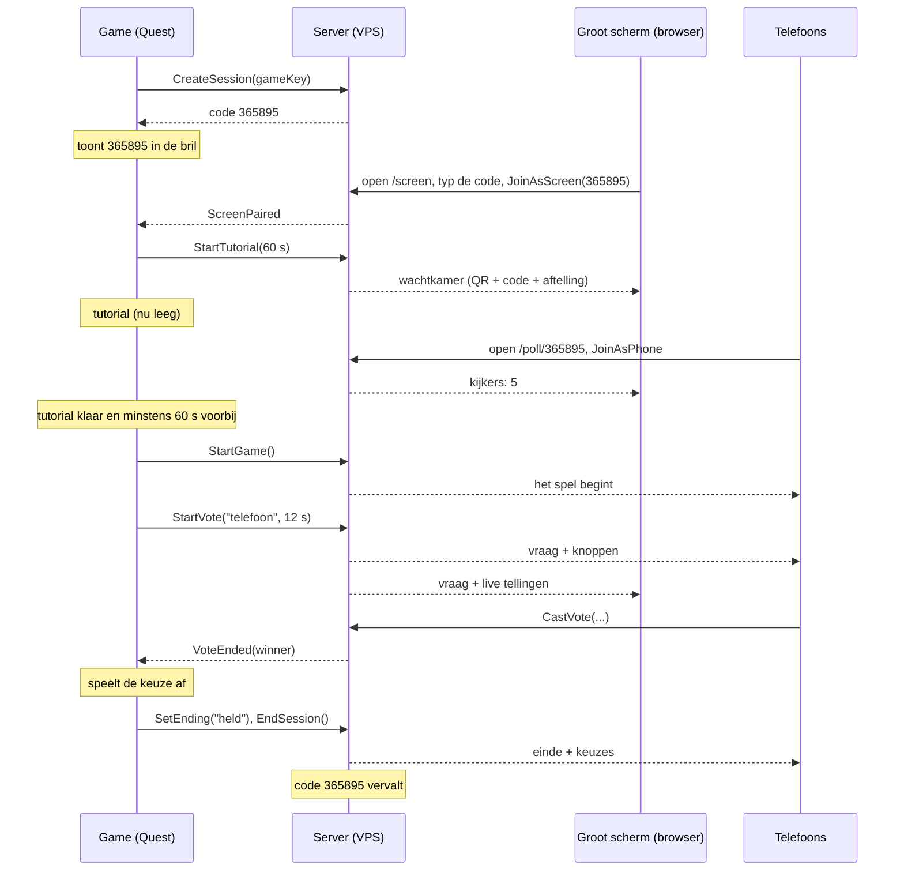

# Plan: Home Alone VR online (website + groot scherm + SignalR)

19 oktober 2026 · fase 1 t/m 3 gebouwd, fase 4 klaar (wacht op de VPS)

## Stand van zaken

| Fase | Status |
|---|---|
| 0. Spike | Gekozen voor **optie B** (eigen SignalR-client, `CN_VR/Assets/ApplicationConnection/Scripts/Net/`). Getest tegen de echte server vanuit `webapp/tests`, en gecompileerd tegen de Unity 6.3-DLL's. **Nog te doen: testen in een echte Quest-build.** |
| 1. Server | Klaar: `webapp/src/CollectiveNarratives.Web`, 53 tests groen. Node-versie verwijderd. `UNITY-KOPPELING.md` herschreven. |
| 2. Websitepagina's | Klaar: `/`, `/poll/{code}`, `/screen`, `/screen/{code}`, `/host` (nep-game). Volledige flow getest in de browser. |
| 3. Unity | Klaar in de testscene `ApplicationConnection`: code in de bril, koppelen, tutorial-placeholder + 60 s, teststemming. **Nog niet in Play mode getest** (Unity was niet bereikbaar vanuit Claude). |
| 4. DevOps | Bestanden klaar: `webapp/Dockerfile`, `deploy/`, `.github/workflows/web.yml`. Wacht op de VPS (`deploy/README.md`) en daarna DNS en GitHub-secrets (`deploy/EIGENAAR.md`). |
| 5, 6 | Nog niet begonnen. Plekken op `/screen` staan klaar. |

Dit plan beschrijft hoe de stem-website online komt op onze VPS en ons domein, met een groot-schermpagina en een SignalR-koppeling met de game. Zodra we op de server kunnen, werken we het af van boven naar beneden. Alleen de website gaat online, de game niet.

## In het kort

- **Eén domein:** `collective-narratives.app`. Daarop staan de telefoon-app, het grote scherm en de SignalR-hub.
- **Per speelsessie een code van 6 cijfers**, bv. `365895`. De game maakt die code aan bij het starten en toont hem **in de VR-bril**. Ze werkt alleen voor die sessie en verdwijnt als de game klaar is.
- **Koppelen met het grote scherm:** op de projectorlaptop open je `collective-narratives.app/screen` en typ je de code uit de bril. Pas als het grote scherm gekoppeld is, gaat de game verder.
- **Daarna de tutorial (nu nog leeg) als wachtkamer.** Het grote scherm toont de QR (`collective-narratives.app/poll/365895`) **en** de code in grote cijfers, zodat het publiek kan joinen. Wie niet wil scannen, gaat naar `collective-narratives.app` en typt de code. Het echte spel start als de speler klaar is met de tutorial **en** er minstens 60 seconden voorbij zijn.
- **De telefoon-app blijft zoals hij nu is** (zelfde schermen en Home Alone-stijl). Alleen de verbinding eronder verandert.
- **Game ↔ website gaat via SignalR.** De server wordt daarom ASP.NET Core in plaats van Node. De game hoeft niet meer te pollen: hij krijgt de uitslag als een event.
- **DevOps:** elke merge naar `main` die `webapp/` raakt, wordt automatisch getest, als Docker-image gebouwd en op de VPS gezet. Unity-wijzigingen starten deze pipeline niet.
- **Later:** het zicht van de speler op het grote scherm (fase 5) en de minimap (fase 6).

## Startpunt: wat er nu in de repo staat

| Wat | Waar | Wat ermee gebeurt |
|---|---|---|
| Node-stemserver + telefoonpagina + hostpagina | `webapp/` (PR #1) | De server wordt herschreven in ASP.NET Core. HTML, CSS en de schermlogica van de telefoon nemen we over. |
| Afspraken webapp ↔ Unity (HTTP-polling) | `webapp/UNITY-KOPPELING.md` | Wordt herschreven voor SignalR (fase 1). |
| Testscene: wachtkamer, telefoon-keuze, uitslag | `CN_VR/Assets/ApplicationConnection/` | `VoteClient.cs` (HTTP-polling) wordt `SessionClient.cs` (SignalR). Het UI-scherm in Unity (QR, kijkers, stemming) verhuist naar de website, want op de Quest is er geen "groot scherm"-venster. In de bril komt alleen nog een paneel met de koppelcode. |
| Build target | Android (Quest, OpenXR) | Belangrijk voor de SignalR-client en het spelerzicht, zie de risico's. |

Klein punt: de laatste commits (`1ea4511` t/m `d1d2bbf`) staan rechtstreeks op `main`. De workflow zegt eigen branch + PR. Met de branch-beveiliging uit fase 4 kan dat niet meer per ongeluk.

## Hoe het straks werkt

1. **Start:** de speler start het spel. De game maakt een sessie aan en toont de code van 6 cijfers op een paneel in de bril.
2. **Koppelen:** iemand bij de projectorlaptop opent `/screen` en typt die code. Het grote scherm is nu gekoppeld en de game krijgt `ScreenPaired`. Zonder koppeling gaat de game niet verder (zie de risico's).
3. **Tutorial en joinen:** de game gaat door naar de tutorial (nu nog leeg). Ondertussen toont het grote scherm de QR, de code, het aantal kijkers en een aftelling van 60 s. Het publiek joint met de telefoon.
4. **Spel start:** zodra de speler klaar is met de tutorial **en** er minstens 60 s voorbij zijn, roept de game `StartGame()` aan. Is de speler sneller klaar, dan wacht de game tot de 60 s om zijn, zodat het publiek genoeg tijd heeft om te joinen. Duurt de tutorial langer, dan wacht de game op de speler. Zolang de tutorial leeg is, wacht de game gewoon de 60 s af. Late kijkers kunnen daarna nog joinen.
5. **Spel en einde:** stemmen en samen-acties zoals nu, daarna het einde. De code vervalt.



### Sessies en codes

| Regel | Voorstel |
|---|---|
| Wie maakt de code | De game, met `CreateSession` bij de start, en toont hem in de bril. Daarvoor heeft de game een geheime **game key** nodig, zodat niet iedereen sessies kan aanmaken. |
| Koppelen | Het eerste scherm dat `JoinAsScreen(code)` doet, koppelt de sessie en de game krijgt `ScreenPaired`. Tot dan staat de code alleen in de bril, dus niemand anders kan eerder koppelen. Telefoons kunnen pas joinen na de koppeling. Een tweede scherm mag later ook nog meekijken. |
| Wachtkamer | Begint na de koppeling en duurt minstens 60 s, en langer als de tutorial dan nog niet klaar is. De game beslist wanneer het spel start (`StartGame`). De server toont alleen de aftelling. |
| Vorm | 6 cijfers, `100000`–`999999`, met een cryptografische random. De server checkt dat de code niet al in gebruik is. |
| Hergebruik | Een gebruikte code komt pas na 24 uur terug in de pot. Zo komt een oude QR nooit in een nieuwe sessie terecht. |
| Einde | `EndSession()` door de game: de code werkt meteen niet meer. Telefoons die nog open staan, houden hun eindscherm. Nieuwe bezoekers zien "Deze sessie is afgelopen". |
| Game valt weg | Na 2 minuten zonder verbinding vervalt de sessie. Binnen die tijd kan de game terugkomen met `ResumeSession(code, gameToken)`. |
| Maximumduur | 2 uur, daarna vervalt de sessie altijd (opruimen). |
| Raden van codes | Rate limit per IP op joinen (bv. 20 per minuut). Een fout geraden code geeft alleen toegang tot stemmen in die ene sessie. |
| Opslag | In het geheugen van de server. Er draait één server, dus geen database of Redis nodig. Na een herstart zijn lopende sessies weg. Dat is aanvaardbaar: niet deployen tijdens een voorstelling. |

### URL's op `collective-narratives.app`

| URL | Voor wie | Wat |
|---|---|---|
| `/` | publiek | Startpagina: "Vul de code in" (6 vakjes), daarna naar `/poll/{code}` |
| `/poll/{code}` | publiek | De telefoon-app van nu. Een onbekende of verlopen code geeft een nette melding. |
| `/screen` | groot scherm | Koppelpagina: "Typ de code uit de VR-bril" (6 vakjes), daarna naar `/screen/{code}` |
| `/screen/{code}` | groot scherm | Het grote scherm van die sessie. Bij het openen wordt de sessie gekoppeld. Een onbekende of verlopen code geeft een nette melding. |
| `/hubs/session` | alles | SignalR-hub |
| `/api/qr/{code}.png` | groot scherm | QR-afbeelding |
| `/healthz` | DevOps | Gezondheidscheck voor de deploy |

Het grote scherm kan niets sturen behalve de koppeling zelf. Daarna toont het alleen wat er gebeurt, dus het heeft geen extra sleutel nodig. Start de game opnieuw, dan komt er een nieuwe code en typ je die opnieuw in op `/screen`.

### Groot scherm (`/screen`)

Layout in 16:9, in dezelfde Home Alone-stijl als de telefoons:

```
┌──────────────────────────────────────────────┬──────────────────┐
│                                              │  STEMMING        │
│          ZICHT VAN DE SPELER                 │  vraag + balk    │
│          (fase 5; tot dan: titelbeeld)       │  live tellingen  │
│                                              │                  │
│                                              ├──────────────────┤
│                                              │  MINIMAP         │
│                                              │  (fase 6)        │
├──────────────────────────────────────────────┴──────────────────┤
│  5 van 5 kijkers verbonden                    code 365895       │
└─────────────────────────────────────────────────────────────────┘
```

- **Koppelen:** "Typ de code uit de VR-bril" met 6 vakjes. Nog geen QR: die komt pas na de koppeling.
- **Wachtkamer (tijdens de tutorial):** groot de QR, de 6 cijfers en `collective-narratives.app`, plus het aantal verbonden kijkers en een aftelling van 60 s. Staat de aftelling op 0 en is de speler nog bezig met de tutorial, dan toont het scherm "De speler is bijna klaar...".
- **Tijdens het spel:** spelerzicht groot, stemming rechts, code klein onderaan (late kijkers kunnen nog joinen).
- **Samen-actie:** de grote knop met "3 van 5 drukken..." en een balk. "Wees stil" groot in beeld.
- **Einde:** naam van het einde en de gekozen keuzes. De verhaalboom kan later.

## SignalR-contract (wordt de nieuwe `UNITY-KOPPELING.md`)

Eén hub `/hubs/session`. Elke verbinding heeft een rol: `game`, `screen` of `phone`. De server zet ze in een SignalR-groep per sessiecode.

**Game → server** (invoke, met antwoord):

| Methode | Antwoord | Opmerking |
|---|---|---|
| `CreateSession()` | `{ code, gameToken, joinUrl }` | game key als `access_token` bij het verbinden |
| `ResumeSession(code, gameToken)` | `bool` | na een verbroken verbinding |
| `StartTutorial(seconds)` | — | na `ScreenPaired`: wachtkamer begint, het scherm toont de aftelling (60 s) |
| `StartGame()` | — | einde wachtkamer: tutorial klaar en minstens 60 s voorbij |
| `StartVote(id, question, options[], seconds, message)` | `voteId` | Voorstel: **de game stuurt de vraag en opties mee**, zodat alle verhaalinhoud in Unity zit en de server generiek blijft (nu staan ze in `choices.js`) |
| `Decide(voteId, option)` | — | Kevin koos zelf (gelijkspel of geen stemmen) |
| `StartTogether(label, seconds)` | — | samen-actie |
| `SetEnding(ending)` | — | `held` / `weg` / `cadeau` |
| `EndSession()` | — | code vervalt |

**Server → game** (events, geen polling meer):

| Event | Inhoud |
|---|---|
| `ScreenPaired` | `{ screens }`. Het grote scherm is gekoppeld: de game gaat door naar de tutorial. |
| `ViewersChanged` | `{ viewers }` |
| `VoteTally` | live tellingen (optioneel, voor een HUD in de game) |
| `VoteEnded` | `{ voteId, winner, decidedBy, total, options[] }`. `winner == ""` betekent: Kevin beslist. |
| `TogetherEnded` | `{ attempt, success, presses, needed }` |

**Telefoon → server:** `JoinAsPhone(code, clientId)`, `CastVote(voteId, option)`, `Press()`.
**Groot scherm → server:** `JoinAsScreen(code)`.
**Server → telefoons en scherm:** `State` met **exact dezelfde vorm als `/api/state` nu** (`viewers`, `active`, `vote`, `last`, `together`, `lastTogether`, `ending`, `history`). Zo hoeft de telefoon-UI niet te veranderen. Extra velden: `code`, `joinUrl`, `screens`, `phase` (`pairing` / `lobby` / `playing` / `ended`) en `lobbyRemaining` (seconden, voor de aftelling). Extra event: `SessionEnded`.

De regels blijven hetzelfde: 12 s standaard, de laatste druk telt, gelijkspel of niemand stemt betekent dat Kevin beslist, samen-actie gelukt als iedereen drukt.

## Techniek

### Server

- **ASP.NET Core op .NET 10 (LTS)**, minimal API + SignalR, met statische bestanden in `wwwroot/`. Eén container.
- De **JS-client** `@microsoft/signalr` als lokaal bestand in `wwwroot/js/` (geen CDN). `common.js` gebruikt die in plaats van de kale WebSocket.
- **QR** server-side met de NuGet-package QRCoder.
- Achter de proxy: `ForwardedHeaders` aan, zodat https en IP's kloppen (nodig voor de rate limit).
- Meer dan één server-instantie is niet nodig. Komt dat ooit, dan een Redis-backplane + sticky sessions.

### Unity

- `SessionClient.cs` vervangt `VoteClient.cs`, met **dezelfde publieke methodes** (`RunVote`, `Decide`, ...). `ApplicationConnection.cs` hoeft dan nauwelijks te veranderen.
- **Startflow in de game:** `CreateSession` → codepaneel in de bril (world-space Canvas, groot en goed leesbaar) → wachten op `ScreenPaired` → `StartTutorial(60)` en de tutorial laden (nu een lege placeholder) → als de tutorial klaar is **en** er minstens 60 s voorbij zijn: `StartGame()`. Is de speler eerder klaar, dan toont de bril "Wachten op het publiek..." met de resterende tijd. De 60 s-timer loopt in de game (`Time.unscaledTime`). De server gebruikt `lobbyEndsAt` alleen voor de aftelling op het scherm.
- SignalR-events komen binnen op een achtergrond-thread. Zet ze in een queue die in `Update()` wordt afgehandeld (Unity-API's mogen alleen op de main thread).
- **Optie A:** de officiële client `Microsoft.AspNetCore.SignalR.Client` via NuGetForUnity. Met alleen de WebSockets-transport en een `link.xml`, zodat IL2CPP op Android niets wegstript.
- **Optie B (terugval):** een eigen mini-client van ongeveer 150 regels op `System.Net.WebSockets.ClientWebSocket`. Het SignalR JSON-protocol is simpel: een handshake en daarna JSON-berichten die eindigen op teken `0x1E`. Geen dependencies.
- **Gekozen: optie B.** Geen packages en geen IL2CPP-stripping om op te letten, en vanuit de servertests te testen. Wel nog te checken in een echte Quest-build.
- Serveradres en game key in een `ServerConfig`-ScriptableObject. In de Editor kan het `http://localhost:5000` zijn, op de Quest `https://collective-narratives.app`. Via https is "Allow downloads over HTTP" niet meer nodig.

### Zicht van de speler (fase 5)

| Optie | Hoe | Voor | Tegen |
|---|---|---|---|
| **5a. JPEG-frames via SignalR** | Spectator-camera → RenderTexture 640×360 → `AsyncGPUReadback` → JPEG (q≈60) → ~10 fps naar de hub → de server stuurt het door naar de scherm-groep | Simpel, werkt overal, geen extra server | ~0,3–0,5 MB/s, wat schokkerig. De max-berichtgrootte van SignalR moet omhoog (standaard 32 KB), MessagePack-protocol voor binaire data. |
| **5b. WebRTC** | `com.unity.renderstreaming`/`com.unity.webrtc`, met SignalR als signaling en **coturn** (TURN) op de VPS | Vloeiend, 30 fps, lage vertraging | Meer werk. Hardware-encoding op de Quest is een risico. Extra poorten open (3478 + UDP-range). |
| **Noodoplossing** | Meta Quest casting naar de browser op de projectorlaptop, naast `/screen` | Nul werk | Niet in onze eigen pagina in te bouwen |

Voorstel: eerst 5a. Is dat te schokkerig, dan 5b.

## DevOps

### Mappen in de repo

```
webapp/                                vervangt de Node-app
  CollectiveNarratives.sln
  src/CollectiveNarratives.Web/
    Program.cs
    Hubs/SessionHub.cs
    Sessions/                          SessionStore, Session, VoteRound, CodeGenerator
    wwwroot/                           index.html (code invullen), poll.html, screen.html, css/, js/
  tests/CollectiveNarratives.Web.Tests/   xUnit: codes, stemmen tellen, hub-integratie
  Dockerfile
  UNITY-KOPPELING.md                   herschreven voor SignalR
deploy/
  docker-compose.yml                   web + Cloudflare Tunnel
  README.md                            VPS-setup stap voor stap
.github/workflows/web.yml              CI + CD
```

### Pipeline (`.github/workflows/web.yml`)

Start alleen bij wijzigingen in `webapp/**`, `deploy/**` of de workflow zelf.

| Wanneer | Jobs |
|---|---|
| Pull request naar `main` | `checkout` (**`lfs: false`**, zodat we geen LFS-quotum verbruiken) → `dotnet test` → `docker build` (zonder push) |
| Push/merge naar `main` | hetzelfde, plus: image pushen naar GHCR (`ghcr.io/renzoraes2006/collectivenarratives-web:<sha>` en `:latest`) → **deploy**: `docker-compose.yml` via `scp` naar de VPS, dan via SSH `docker compose pull && docker compose up -d` → **smoke test**: `curl https://collective-narratives.app/healthz` |
| Handmatig (`workflow_dispatch`) | opnieuw deployen of terugrollen naar een oudere `<sha>` |

- Deploy via een GitHub **environment** `production`. Daar kan een verplichte goedkeuring op, zodat er niets live gaat vlak voor een voorstelling.
- **Secrets in GitHub:** `VPS_HOST`, `VPS_USER`, `VPS_SSH_KEY` (een aparte deploy-sleutel, alleen hiervoor).
- **Secrets op de VPS** (`/opt/collective-narratives/.env`, niet in git): `GAME_KEY`, `IMAGE_TAG`.
- **GHCR:** het image bevat niets geheims. De deploy logt op de VPS tijdelijk in met het token van de run zelf, dus geen PAT nodig. Extra secret: `VPS_KNOWN_HOSTS` (gecontroleerde host key van de VPS).
- **Branch-beveiliging op `main`:** PR verplicht, CI moet groen zijn, geen directe pushes.
- Een private repo heeft 2000 gratis Actions-minuten per maand. Dat is ruim genoeg.

### VPS (eenmalig, zodra we toegang hebben)

1. **OS:** Ubuntu 24.04 LTS, updates erop, `unattended-upgrades` aan.
2. **Gebruiker:** `deploy` (in de groep `docker`, geen root). SSH alleen met sleutels, root-login en wachtwoord-login uit. Eventueel `fail2ban`.
3. **Firewall (`ufw`):** alleen 22 open. De website komt binnen via de Cloudflare Tunnel (uitgaande verbinding), dus 80 en 443 blijven dicht (later voor WebRTC wel 3478 + een UDP-range).
4. **Docker Engine + compose-plugin** installeren.
5. **Map:** `/opt/collective-narratives/` met `.env` (`GAME_KEY`, `IMAGE_TAG`, `TUNNEL_TOKEN`).
6. **DNS via Cloudflare:** het domein staat bij name.com geregistreerd, maar de nameservers wijzen naar Cloudflare. De tunnel maakt zelf de DNS-records aan.
7. **Eerste deploy met de hand** (compose up), dan pas de pipeline aanzetten.

### Cloudflare Tunnel (https zonder open poorten)

- De container `tunnel` (`cloudflared`) bouwt een uitgaande verbinding naar Cloudflare. Bezoekers gaan naar Cloudflare, Cloudflare stuurt het verzoek door de tunnel naar `http://web:8080`.
- In het Cloudflare-dashboard: tunnel `collective-narratives`, public hostname `collective-narratives.app` → `http://web:8080` (en `www` naar hetzelfde). Het token van de tunnel staat als `TUNNEL_TOKEN` in de `.env` op de VPS.
- Cloudflare regelt het https-certificaat. `.app` werkt **alleen via https** (HSTS-preload), dat is dus in orde.
- Cloudflare stuurt het echte IP van de bezoeker mee in `X-Forwarded-For` (nodig voor de rate limit).
- WebSockets (SignalR) werken zonder extra instellingen.

### Beheer

- Logs: `docker compose logs -f web`.
- Uptime: gratis monitor (UptimeRobot of Uptime Kuma) op `/healthz`.
- Terugrollen: `IMAGE_TAG=<oude sha> docker compose up -d`, of de workflow handmatig starten met die sha.
- Lokaal ontwikkelen: `dotnet run` (poort 5000) of `cd webapp && docker compose up --build`.

## Fasen en taken

Fase 1, 2 en 3 kunnen **nu al** (alles lokaal). Fase 4 zodra we op de VPS kunnen.

| Fase | Wat | Wie (voorstel) | Klaar als |
|---|---|---|---|
| **0. Beslissen + spike** | Open vragen hieronder beantwoorden. Spike: SignalR-client in een Quest-build. | team / Unity | Er is gekozen tussen optie A en B. Een Quest-build ontvangt een event van een lokale server. |
| **1. Server in ASP.NET Core** | Sessies + codes, hub, rate limit, QR, healthz, tests. `UNITY-KOPPELING.md` herschrijven. Node-versie weg. | web | `dotnet test` groen. Lokaal: sessie aanmaken, met 3 browsers stemmen, uitslag komt binnen. |
| **2. Websitepagina's** | `/` (code invullen), `/poll/{code}` (huidige app op SignalR), `/screen` (code invullen) en `/screen/{code}` (wachtkamer met aftelling, stemming, samen-actie, einde) | web | De volledige game flow werkt met de hostpagina als "nep-game", inclusief koppelen. |
| **3. Unity SessionClient** | `SessionClient.cs`, `ServerConfig`, `ApplicationConnection` aangepast. Codepaneel in de bril, tutorial-placeholder en 60 s-timer. UI-overlay in Unity enkel nog als debug. | Unity | In de Editor tegen de lokale server: code in beeld, koppelen via `/screen`, na 60 s start het spel. Zonder polling. |
| **4. DevOps** | VPS-hardening, DNS, Docker/Cloudflare Tunnel, workflow, secrets, branch-beveiliging | DevOps | Een merge naar `main` staat binnen ~5 min live. `https://collective-narratives.app/healthz` geeft OK. |
| **5. Spelerzicht** | 5a (JPEG via SignalR), daarna eventueel 5b (WebRTC + coturn) | Unity + web | Het grote scherm toont het beeld van de Quest met < 1 s vertraging. |
| **6. Minimap** | Later | — | — |

Fase 1 en de spike uit fase 0 kunnen tegelijk: andere mappen, andere mensen.

## Open vragen voor het team

1. **Game op de Quest (standalone) of pc + Link?** Het build target is Android, dus we gaan uit van standalone. Bij pc + Link wordt het spelerzicht veel makkelijker.
2. **Vragen en opties in de game of op de server?** Voorstel: in de game (zie `StartVote`).
3. **VPS:** welke provider en specs, welk OS, en wie krijgt SSH-toegang?
4. **Domein:** is `collective-narratives.app` geregistreerd (de checkout bij name.com was nog niet afgerond)? Automatisch verlengen uit?

## Risico's

| Risico | Gevolg | Wat we doen |
|---|---|---|
| SignalR-client werkt niet op de Quest (IL2CPP/stripping) | Geen koppeling | Spike in fase 0, met optie B als terugval |
| Wifi op de locatie blokkeert of is traag | Telefoons of game kunnen niet verbinden | Telefoons kunnen op 4G/5G. Voor de Quest een hotspot als back-up. De game speelt verder als de server wegvalt (Kevin beslist). |
| Groot scherm koppelt niet (geen internet, typfout, server plat) | Speler blijft op het codescherm | Een foute code geeft een duidelijke melding op `/screen`. Voorstel: na 2 minuten verschijnt in de bril "Spelen zonder groot scherm" (dan beslist Kevin alle keuzes). |
| Deploy tijdens een voorstelling | Sessies weg | Goedkeuring op de `production`-environment, niet deployen op speeldagen |
| Spelerzicht kost te veel op de Quest | Framedrops in VR | Lage resolutie/fps, uit te zetten met een vlag |
| Iemand raadt codes | Ongewenste stemmen | Rate limit, codes vervallen, sessies kort |
